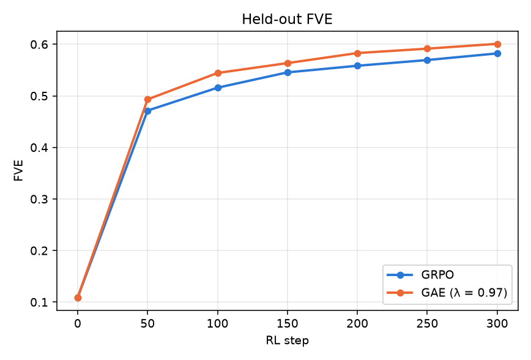

# Per-token advantages for NLA RL: GAE on a prefix-readout critic

GRPO gives every token of an explanation the same advantage: the group-normalised
final reward. This document describes a drop-in replacement that credits each
token with the change in a learned per-prefix value (GAE with λ = 0.97), the
critic change that makes per-prefix values available at no extra cost, the
leak tests that any such baseline has to pass, and the small-scale results
(SmolLM2-135M, single seed) that motivated it. The reference implementation is
in [`examples/small_scale_gae/`](../examples/small_scale_gae/); the Miles
mapping is in §5.

## 1. Results at small scale

Attention-readout critic, 64 prompts × 8 samples per step, 300 steps, seed 0,
both runs from the same frozen SFT actor and critic, both training actor and critic.
Held-out FVE is each run's trained pair (its actor's explanations scored by its own
trained critic) on 8,192 held-out vectors.



| step | GRPO | GAE 0.97 |
|---|---|---|
| 50 | 0.471 | 0.493 |
| 100 | 0.516 | 0.544 |
| 150 | 0.545 | 0.563 |
| 200 | 0.558 | 0.583 |
| 250 | 0.569 | 0.591 |
| 300 | 0.582 | 0.601 |

Both ran on the same GPU type (one A6000 each). GAE 0.97 is ahead at every eval and
reaches GRPO's step-300 score by step 200. The training-rollout FVE from each run's
live critic, a 25-step moving average, has GAE ahead at every step after 40. GAE also
truncated less: 0.70 % of rollouts hit the length cap or failed to parse over the run,
against 1.02 % for GRPO, at the same mean explanation length.

Variants that were tried and dropped at the step-100 gate: λ = 0.90, mixing 10 % of
the whole-sequence advantage back in, Dr.GRPO-style scaling, and the pure control
variate (λ = 1), which cuts advantage variance to 0.63–0.68× GRPO's but saves only
6–16 % of steps. GAE 0.97 also beat GRPO at 1,024 rollouts per step (twice the
compute) from step 100 on, and a 2× actor learning rate helped GAE at every eval.

**Cost.** Same-GPU step time was 12.5 s for GAE and 12.6 s for GRPO. The only added
work is the ridge fit, about 0.1 s per step; the per-prefix critic scores come out of
the reward-scoring pass that GRPO already runs.

**Caveats.** One seed per arm, a 135M actor, 300 steps. Nothing here has been run on
the 7B–70B models.

## 2. Why GRPO cannot do this on the released critic

The released critic is suffix-anchored: the prompt ends in `</text> <summary>` and the
vector is read at the last token. A value for the prefix `toks[:t]` would need a
separate forward pass with the suffix appended after token t, for every t. The
multi-suffix trick (one pass with a block mask, one suffix copy every 10 tokens) was
tried and matched the final-token critic on quality, but it is still one readout per
cut and the cut spacing limits the resolution.

## 3. The prefix-readout critic

Replace "read at the suffix token" with a pooling layer whose queries are constants:

```
AttnReadout(h, last):            # h [B, T, d] = last kept block's outputs, causal backbone
    x = RMSNorm(h)
    K = Wk x, V = Wv x             # per head
    s = q · K / sqrt(d_head)       # q: learned [heads, d_head], init 0 => mean pooling
    out[j] = softmax(s[:last[j]]) · V[:last[j]]      # one readout per requested prefix
    return Wo out
```

Because the queries do not depend on the prefix, the softmax-pooled value of every
prefix is a ratio of running sums. One `logcumsumexp` scan over the sequence gives the
readout at **all** T prefixes in O(T), in fp32 log space so no prefix underflows
(`core.py: AttnReadout.forward`; `forward_masked` is the dense reference it is checked
against). The critic prompt is then just `prefix + explanation tokens` with no suffix.

Training is unchanged: SL on explanation → vector with the loss at the full-length
readout only (`train_ar.py --arm attn`). At small scale this arm matched the
final-token critic (eval FVE 0.465 vs 0.458) with a slightly cheaper critic step, since
there is no suffix to run. The intermediate readouts are never trained directly; they
are only inputs to a *fitted* baseline (§4.2), so their bias does not matter.

## 4. The advantage

Notation: a group of n rollouts of one prompt, rollout i has response tokens
`toks[0:L_i]`, final reward `R_i = -mse_nrm` (or −2 on failed extraction), GRPO
advantage `A_i = (R_i − mean_g) / sd_g`. State t is `toks[:t]`.

### 4.1 Leak-free prefix scores

`vbase2.PrefixFeatures.scan` produces, in one critic pass per rollout batch, both the
reward and a score for every state:

- The explanation body is located in the **bytes of the actor's own tokens**, never by
  re-tokenising the extracted text or searching the decoded string. The byte offset
  of state t is the sum of the byte lengths of tokens `< t`. `k(t)` = number of body
  tokens visible at state t (after the full `</explanation>` has been emitted, k stops
  at the body minus trailing whitespace).
- `S[i, t] = −mse` of the readout after `k(t)` body tokens, from one causal pass over
  `critic_prefix + body_ids` with the prefix scan. `S[i, t]` is NaN where k = 0.
- Every rollout gets scores, failed ones included. Nothing is gated on the future.
- Rollouts whose body ids start with the canonical ids of the extracted explanation
  (nearly all) take their reward from the same pass; the rest are re-scored the
  standard way. The fused rewards match separate scoring to 2.4e-7.

Anything that multiplies `∇ log π(a_t | s_t)` must be a function of `toks[:t]`, the
other rollouts, and past steps only. The first implementation violated this four ways
(scores from re-tokenised text, prefix scores that saw the current token, a
forward-filled "first value" that was the rollout's own, and a feature gated on
successful extraction). All four made the arm look better than it was. §6 has the tests.

### 4.2 Control-variate value

Per rollout i and state t, features from `S[i, t]`, the other n−1 rollouts' rewards and
scores at t, and nothing from rollout i's own future:

```
rloo  = mean of the other rollouts' R           sdo = std of the other rollouts' R
om_t  = mean of the other rollouts' S at t     done_t = fraction of others finished by t
z = clip([(S_t − rloo)/sdo, (S_t − om_t)/sdo, (om_t − rloo)/sdo], ±10)
F_t = [z, S_t missing, t/200, done_t]
```

`f_t = D(F_t, bin(t)) · β` is a linear predictor of `A_i` with separate weights per
20-token position bin (`vbase2.design`). β is a ridge solution of decayed normal
equations (decay 0.9 per step, rows weighted 1/L_i²) accumulated from **previous
steps only**: a step's rollouts are added after that step's advantages are computed,
so the baseline at step s is fit on steps < s and the gradient stays unbiased. With
λ = 1 the advantage is `A_i − f_t` ("cv"); with β = 0 it is exactly GRPO.

### 4.3 GAE

Treat `V_t = f_t` as the value of state t, `V_{L_i} = A_i` as the terminal value, no
intermediate rewards, γ = 1:

```
adv_t = Σ_{k≥0} λ^k (V_{t+k+1} − V_{t+k})          λ = 0.97
```

computed by the usual backward recursion (`vbase2.ControlVariate.step`). λ = 1 gives
the control variate exactly; λ < 1 is biased by design, as always with GAE. The
`gae_mix` option adds `w · A_i` back to every token; w = 0.1 did not help.

### 4.4 Actor loss

Unchanged except that the per-token advantage tensor `[N, L_max]` replaces the
per-sequence scalar: `−adv_t · ratio + kl · ½ (log π − log π_ref)²`, mean over a
sample's tokens, mean over samples, one optimizer step per rollout batch, gradient
clip 1.0.

## 5. Mapping onto the Miles training stack

The repo's RL loop (`docs/design.md` §4.3) already runs the critic as a second
`RayTrainGroup` and scores rewards with the live critic through `critic_fwd`. The
changes, by file:

1. **Critic model** (`nla/models.py`): add the `AttnReadout` module as the head of
   `NLACriticModel` behind a sidecar flag (e.g. `critic.readout: attn`). The
   suffix-anchored invariant in the repo guidelines applies to the `final` readout only; the
   attn critic has no suffix, and `critic_suffix_ids` is empty for it. Initialise the
   queries to zero and keep the identity-initialised `Linear(d, d)` head.
2. **Critic SL loss** (`nla/loss.py: nla_critic_loss`): for the attn readout, extract
   at the full-length prefix (`last = len − 1`) instead of `tokens[-1]`. No other
   change to critic SFT.
3. **Reward** (`nla/reward.py: nla_rm` and `critic_fwd`): have `critic_fwd` return the
   `[B, L]` prefix readouts (one scan, same cost) and compute `S` per the byte
   alignment in `vbase2.PrefixFeatures.align`, using the actor's token ids from the
   sample. Stash `S` (1-D, length L_i + 1, NaN-padded) in
   `multimodal_train_inputs["nla_prefix_scores"]` next to `nla_activation`.
4. **Advantages** (`nla/train_actor.py`): when `role == "actor"`, replace the GRPO
   advantage with `ControlVariate.step(S, rewards, lengths, n, A_grpo,
   gae_lambda=0.97)` before `_train_core`. The fit state is a few KB of numpy on rank
   0; broadcast β after each update so every data-parallel rank uses the same
   baseline. Keep `--advantage-estimator grpo` for everything else Miles does with
   it; the per-token tensor goes in where Miles expects `advantages` of shape
   `[N, response_len]`, which the PPO path already supports.
5. **Flags** (`configs/rl.sh`): `--nla-baseline {grpo,cv,gae}`, `--nla-gae-lambda 0.97`,
   `--nla-vb-decay 0.9`. Default off, so existing runs are bit-identical.

The actor learning rate interacts with this: at small scale GAE kept improving at 2×
the GRPO learning rate while GRPO did not, so re-scan the actor LR once GAE is on.

## 6. Tests to run before trusting any per-token baseline

The shipped `vbase2.py` passed all three of these; re-run them after any change to
the alignment, the features or the critic readout:

- **Alignment**: for sampled token sequences, `k(t)` and the body ids must depend on
  `toks[:t]` only (change a later token, nothing before it moves).
- **End-to-end counterfactual**: take pairs of rollouts that share a prefix and diverge
  at token t, swap the continuations, and verify in fp32 that the baseline at every
  state ≤ t is unchanged to the noise floor (2e-6 over 4,177 pairs here). This is the
  test that caught the fourth leak after the other three were fixed.
- **Scan equivalence**: the fused rewards equal separate full scoring (2.4e-7 here), and
  the scan's prefix readouts equal `AttnReadout.forward_masked` with dense masks.

Also log the normalised advantage variance ratio against GRPO in optimizer units
(`vb_norm_adv2_ratio_vs_grpo`, rows weighted 1/L²). The raw ratio before dividing by
the group sd is misleading and once made a leaky baseline look like a 2× variance cut.

## 7. Reproducing the small-scale experiment

The example directory is a minimal recreation of the pipeline on
SmolLM2-135M-Instruct, layer 20, FineWeb text, explanations from an open-weights model
through vLLM. It imports `nla.datagen` and `nla.schema` from this repo for the position
sampler, instruction prompt, extraction regex and templates, so run it with the repo
root on `PYTHONPATH`. Paths come from `NLA_SMALL_DATA` (default `nla_small/data`) and
`NLA_SMALL_BASE` (the frozen SFT checkpoints).

```bash
export PYTHONPATH=$PWD NLA_SMALL_DATA=nla_small/data NLA_SMALL_BASE=nla_small/runs/sft_base
cd examples/small_scale_gae
python extract.py                                    # stage 0: vectors + document split
python explain.py --rank 0 --world 1                 # stage 2: explanations (one process per GPU)
python train_av.py --lr 1e-4 --out $NLA_SMALL_BASE/av
python train_ar.py --arm attn  --lr 1.5e-4 --out $NLA_SMALL_BASE/ar_attn
B=$NLA_SMALL_BASE
python rl.py --arm attn --baseline grpo --seed 0 --av $B/av --ar $B/ar_attn --steps 300 --out runs/grpo
python rl.py --arm attn --baseline gae --gae-lambda 0.97 --seed 0 --av $B/av --ar $B/ar_attn --steps 300 --out runs/gae97
```

Defaults match the runs above: 64 prompts × 8 samples, actor and critic LR 2e-5, k2 KL
coefficient 0.01, 200 new tokens, eval every 50 steps on 8,192 held-out vectors. Each
run writes `log.jsonl` with per-step phase timings and the held-out FVE at every eval;
the figures in this document were drawn from those logs.
